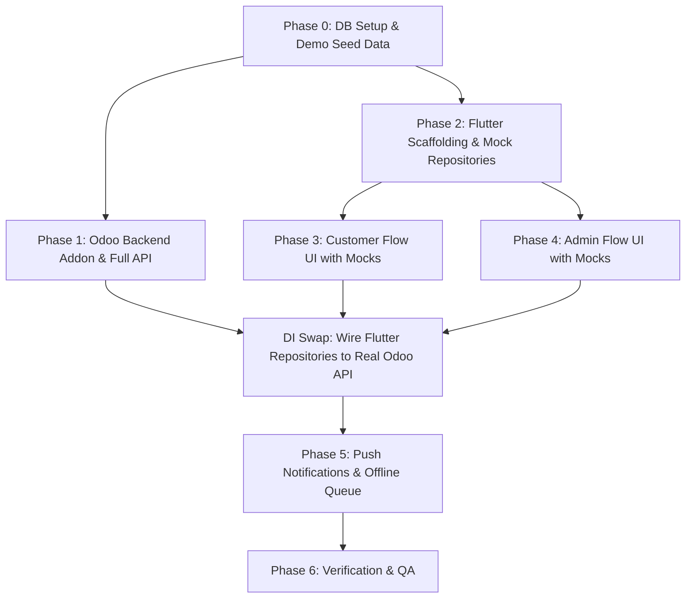

# Implementation Plan: Odoo Helpdesk Mobile App & Backend Integration

> **Scope**: Local demo & complete specification alignment. The [Master Specification](file:///home/muhts/dev/Codes/metamorphosis/odoo-helpdesk-mobile/Odoo%20Helpdesk%20Mobile%20App%20%28Flutter%29%20%E2%80%94%20Master%20Specification.md) is authoritative for all behaviors, security rules, and data contracts.

---

## 1. Goal Description

Develop a high-performance Flutter mobile application (Android/iOS) and custom Odoo 19 backend addon (`helpdesk_mobile_api`) providing complete ticket lifecycle management for two distinct user roles: **Customer** (Odoo portal user) and **Admin / Business Owner** (internal Helpdesk Manager). 

This plan details:
1. Validated local environment status.
2. Complete 23-screen inventory with visual specifications for **Google Stitch** (visual reference only; master spec governs behavior).
3. Comprehensive API implementation plan covering the full Section 5.3 catalogue and Section 14 dynamic custom fields.
4. Parallel frontend/backend development workflow utilizing mock repositories.
5. Push notifications, offline write queue with idempotency, and rigorous verification criteria.

---

## 2. Environment Status (Audited & Verified)

| Component | Detected Version / Specification | Location / Details | Status |
| :--- | :--- | :--- | :--- |
| **Operating System** | Debian GNU/Linux 13 (trixie) x86_64 | Kernel `6.12.113+deb13-amd64` | `VERIFIED` |
| **Flutter SDK** | Flutter 3.47.8 (Channel stable, Dart 3.13.7) | `/media/muhts/New Volume/debian-offloads/flutter` | `READY` |
| **Android Toolchain** | Android SDK 36.0.0, Build-tools 36.0.0 | `/home/muhts/Android/Sdk` | `READY` |
| **Java JDK** | OpenJDK 17.0.21+9 (Temurin) | `/home/muhts/.local/share/jdk-17` | `READY` |
| **Android Licenses** | All SDK licenses accepted | Verified via `flutter doctor -v` | `READY` |
| **PostgreSQL Service** | PostgreSQL Server active | `127.0.0.1:5432` (Role `odoo` configured) | `ACTIVE` |
| **Odoo Source Code** | Odoo 19.0 Final (Community + Enterprise) | `/home/muhts/dev/Codes/metamorphosis/odoo` | `VERIFIED` |
| **Odoo Helpdesk Module** | Enterprise Helpdesk suite installed/available | `.../odoo_enterprise/helpdesk` | `AVAILABLE` |
| **Odoo Python Runtime** | Python 3.13.5 with dedicated virtualenv | `/home/muhts/dev/Codes/metamorphosis/odoo-app/venv` | `READY` |
| **Odoo System Libraries** | `libpq-dev`, `libxml2-dev`, `libldap2-dev`, etc. | All Debian compile dependencies installed | `INSTALLED` |
| **Odoo Config & Addons** | `odoo.conf` includes root metamorphosis path | `/home/muhts/dev/Codes/metamorphosis/odoo-app/odoo.conf` | `CONFIGURED` |

---

## 3. Screen Inventory & Visual Prompts for Google Stitch

> [!IMPORTANT]
> **Design Input vs. Spec Authority**: The visual layouts generated by Google Stitch serve as visual and aesthetic reference. Screen behavior, dynamic schema rendering, allowed actions, data isolation, and state progression are strictly governed by this specification.

Total Screens / Views: **23** (16 Full Screens + 7 Modal Action Sheets)

```
Total Screens: 23
├── Shared Screens (8)
│   ├── S1: Splash & Session Gate
│   ├── S2: Unified Login
│   ├── S3: Customer Self-Registration
│   ├── S4: Forgot / Reset Password
│   ├── S5: Notifications Inbox
│   ├── S6: Profile & Settings
│   ├── S7: Attachment / Media Viewer
│   └── S8: Offline Banner & Network Error State
├── Customer Screens (5)
│   ├── C1: Customer "My Tickets" List
│   ├── C2: Create Ticket (Dynamic Schema Form)
│   ├── C3: Ticket Detail & Conversation Thread
│   ├── C4: Reopen Ticket Bottom Sheet
│   └── C5: Ticket Rating (CSAT)
└── Admin Screens (10)
    ├── A1: Admin Executive Dashboard
    ├── A2: All Tickets Management & Filter Screen
    ├── A3: Admin Ticket Detail & Operations Center
    ├── A4: Approve Ticket Action Sheet
    ├── A5: Reject Ticket Action Sheet
    ├── A6: Assign Agent Action Sheet
    ├── A7: Change Stage Action Sheet
    ├── A8: Bulk Operations Action Sheet
    ├── A9: Customers Directory Screen
    └── A10: Admin Settings & Workload Notification Preferences
```

### 3.1 Shared Screens (8 Screens)

#### S1: Splash & Session Gate Screen
- **Type**: Full Screen
- **Visual Prompt**: Minimalist modern splash. Deep slate/indigo background (`#0F172A`). Centered high-resolution app icon with title "Helpdesk Mobile" and subtle pulsing progress indicator. Bottom display: version `v1.0.0` and session status. Seamless role-based redirect upon initialization.

#### S2: Unified Login Screen
- **Type**: Full Screen
- **Visual Prompt**: Material 3 login. Top branding header and greeting. Text fields for Email and Password with floating labels and password visibility toggle. Right-aligned "Forgot Password?". Prominent "Sign In" button. Bottom footer with "New customer? Create an account" and discreet server health dot.

#### S3: Customer Self-Registration Screen
- **Type**: Full Screen
- **Visual Prompt**: Customer onboarding form. Header with back navigation: "Create Account". Inputs: Full Name, Email, Phone Number, Password, Confirm Password. Terms checkbox. Primary CTA "Sign Up". Footer link: "Already have an account? Sign In".

#### S4: Forgot / Reset Password Screen
- **Type**: Full Screen
- **Visual Prompt**: Clean recovery interface. Padlock graphic illustration. Explanatory text: "Enter your registered email to receive a password reset link". Single email input field. Primary button "Send Reset Link". "Return to Login" link.

#### S5: Notifications Inbox Screen
- **Type**: Full Screen
- **Visual Prompt**: Chronologically grouped notification cards ("Today", "Yesterday", "Earlier"). Each card displays an event icon (ticket created, stage advanced, agent reply), ticket ID (`#128`), time elapsed, and unread blue badge. App bar has "Mark all as read" icon.

#### S6: Profile & Settings Screen
- **Type**: Full Screen
- **Visual Prompt**: User card displaying avatar, full name, email, and role badge ("Customer Portal" or "Helpdesk Administrator"). Settings sections: Account Details, Language Picker (English / বাংলা), Theme (Light / Dark), Notification Preferences, Privacy & Account Deletion Request, and red "Log Out" action.

#### S7: Attachment & Media Viewer Screen
- **Type**: Full Screen Modal
- **Visual Prompt**: Immersive dark viewer (`#000000`). Top bar showing filename, close button, and Share/Download icon. Pinch-to-zoom image viewer, embedded PDF viewer with page controls, and document card fallback.

#### S8: Global States (Empty, Offline Banner, Error)
- **Type**: Overlay & States
- **Visual Prompt**:
  - *Offline Banner*: Persistent top amber bar (`#F59E0B`) stating "Offline mode. Changes are queued and will sync automatically."
  - *Empty State*: Clean illustration with "No tickets found" and "Refresh" CTA.
  - *Error State*: Alert card with clear error description and "Retry" button.

---

### 3.2 Customer Screens (5 Screens)

#### C1: Customer "My Tickets" Screen
- **Type**: Full Screen
- **Visual Prompt**: Top search bar with filter icon. Dynamic horizontal status chips derived from Odoo stages/groups ("All", "Open", "In Progress", "Done", "Rejected"). Ticket cards displaying ticket ID (`#104`), subject, creation date, assigned agent name, and **dynamic stage badge colored by sequence and closing status**. Displays up to 2 custom fields flagged `show.list`. Floating Action Button (FAB) `+` to create ticket.

#### C2: Create Ticket Screen (Schema-Driven)
- **Type**: Full Screen
- **Visual Prompt**: Header with "Cancel" and "Submit Ticket". Standard inputs: Subject (required), Description (multiline), Ticket Type dropdown, Priority stars (0–3). **Dynamic Custom Fields Section**: renders inputs dynamically according to `/meta/ticket-fields` schema (text, selection, boolean, dates, relational pickers). Bottom attachment dropzone showing thumbnail previews with remove buttons.

#### C3: Customer Ticket Detail & Conversation Screen
- **Type**: Full Screen
- **Visual Prompt**: 
  - Header with ticket number, dynamic status badge, and priority. 
  - **Dynamic Stage Progress Stepper**: stages generated dynamically from `/meta/stages` (not hard-coded).
  - Prominent Rejection Card if stage is *Rejected* showing the admin's mandatory rejection reason.
  - Collapsible ticket information section displaying description and customer-visible custom fields.
  - **Customer Chatter Feed**: strictly shows public agent/customer messages and stage progression events. **Never shows internal notes, assignment changes, or admin-only fields**.
  - **Dynamic Action Bar**:
    - "Confirm Resolved" button visible only when ticket is in *Solving* or *Done* (driven by `allowed_actions`).
    - Sticky bottom reply bar with attachment clip and send button. **Disabled on closed tickets unless reopening**.

#### C4: Customer Reopen Ticket Bottom Sheet
- **Type**: Modal Bottom Sheet
- **Visual Prompt**: Triggered when customer reopens a ticket in *Solving* or *Done* within the allowed reopen window. Warning alert: "This will move your ticket back to In Progress". Required multiline input: "Reason for reopening". "Confirm Reopen" button.

#### C5: Customer Ticket Rating & CSAT Screen
- **Type**: Modal / Screen
- **Visual Prompt**: Triggered after resolution. Prompt: "How would you rate our service?". 5 large interactive golden stars. Optional feedback comment box. "Submit Rating" and "Skip" buttons.

---

### 3.3 Admin Screens (10 Screens)

#### A1: Admin Executive Dashboard Screen
- **Type**: Full Screen
- **Visual Prompt**: 4 KPI summary cards (2x2 grid): "Awaiting Approval" (amber/red), "Unassigned" (blue), "Urgent" (red), "Assigned to Me" (purple). Dynamic stage breakdown progress bar. Recent ticket activity feed with quick navigation.

#### A2: All Tickets Management & Filter Screen
- **Type**: Full Screen
- **Visual Prompt**: Search bar (ID, subject, customer). Quick filter chips ("Needs Approval", "Unassigned", "Mine", "Overdue"). Multi-select checkbox mode (supporting 1 to 50 selections) revealing the Bulk Action Bar. Filter sheet with standard filters + **dynamic custom field filter inputs** (`custom[...]`).

#### A3: Admin Ticket Detail & Operations Center
- **Type**: Full Screen
- **Visual Prompt**: Top sticky action bar displaying contextual buttons driven by `allowed_actions`: [Approve], [Reject], [Assign], [Change Stage]. Customer contact card (name, phone with tap-to-call, email with tap-to-email). Three operational tabs:
  1. *Conversation*: Toggle between "Reply to Customer" (blue background) and "Internal Note" (yellow/amber background with lock icon).
  2. *Details & Custom Fields*: Editable priority, type, tags, and admin-editable custom fields.
  3. *Audit History*: Full timeline of stage moves, assignee changes, and internal audit logs.

#### A4: Admin Approve Ticket Bottom Sheet
- **Type**: Modal Bottom Sheet
- **Visual Prompt**: For tickets in stage *New*. Shows ticket summary. Controls to optionally set Priority and Assignee in one step. Comment input with a visibility selector (defaults to customer-visible message; toggleable to internal note). Primary green CTA "Approve Ticket".

#### A5: Admin Reject Ticket Bottom Sheet
- **Type**: Modal Bottom Sheet
- **Visual Prompt**: For tickets in stage *New*. Alert banner "Reject Ticket". Required text area: "Reason for rejection (sent to customer)". Primary red CTA "Confirm Rejection".

#### A6: Admin Assign Agent Bottom Sheet
- **Type**: Modal Bottom Sheet
- **Visual Prompt**: Searchable list of helpdesk team agents with avatars, names, and current open workload counts. "Unassigned" option at top. Tapping an agent immediately reassigns the ticket.

#### A7: Admin Change Stage Bottom Sheet
- **Type**: Modal Bottom Sheet
- **Visual Prompt**: **Dynamically populated list of stages from `/meta/stages`** (ordered by sequence). Current stage marked with a checkmark. Optional comment input (logged to chatter). "Update Stage" button.

#### A8: Admin Bulk Operations Action Sheet
- **Type**: Modal Bottom Sheet
- **Visual Prompt**: Triggered for 1 to 50 selected tickets. Options: "Bulk Approve", "Bulk Assign", "Bulk Change Stage". Confirmation button showing execution progress and per-ticket success/failure report.

#### A9: Customers Directory Screen
- **Type**: Full Screen
- **Visual Prompt**: Searchable list of customer partner records. Each card displays customer avatar, name, email, phone, and total/open ticket count. Tapping opens A2 pre-filtered for that customer.

#### A10: Admin Settings & Workload Notification Preferences
- **Type**: Full Screen
- **Visual Prompt**: Notification event toggles matching spec events: "New ticket raised", "Customer replied", "Ticket reopened or confirmed", with optional "Urgent priority only" filter. Language toggle, Odoo endpoint info, and Logout button.

---

## 4. Architecture & Parallel Execution Strategy



### Development Tracks:
1. **Frontend / Google Stitch Track (User)**: Use the 23 Screen Specifications to generate high-fidelity UI visual references.
2. **Flutter Scaffold Track (Agent)**: Scaffold Flutter clean architecture using `mocktail`-backed mock repositories matching the OpenAPI schema, allowing UI screens (C1-C5, A1-A10) to be built immediately.
3. **Backend Track (Agent)**: In parallel, build `helpdesk_mobile_api` in Odoo with the full endpoint catalogue and seed data.
4. **Integration**: Swap Flutter mock repositories to `DioTicketRepository` via Riverpod dependency injection.

---

## 5. Phased Implementation Plan

### Phase 0: Environment, Database & Demo Seed Data
1. Initialize dedicated database `odoo_helpdesk_db` with `helpdesk` module installed:
   ```bash
   PYTHONPATH=/home/muhts/dev/Codes/metamorphosis/odoo/odoo \
   /home/muhts/dev/Codes/metamorphosis/odoo-app/venv/bin/python3 \
   /home/muhts/dev/Codes/metamorphosis/odoo/odoo/odoo-bin \
   -c /home/muhts/dev/Codes/metamorphosis/odoo-app/odoo.conf \
   -d odoo_helpdesk_db -i helpdesk --stop-after-init
   ```
2. Execute demo seed script (`scripts/seed_demo_data.py`) creating:
   - **7 Standard Stages** in sequence: `New` (1), `Approved` (2), `Tracking` (3), `Work In Progress` (4), `Solving` (5), `Done` (6, closed), `Rejected` (7, closed).
   - Standard Ticket Types (Bug, Question, Request) and Tags.
   - **Users**: 1 Admin user (`admin@helpdesk.local` / `helpdesk.group_helpdesk_manager`), 2 Portal Customer users (`customer1@acme.com`, `customer2@globex.com`).
   - **Sample Custom Fields** covering each supported type (`x_site_location` selection, `x_urgency_notes` text, `x_requires_onsite` boolean, `x_incident_date` date, `x_estimated_cost` monetary).
   - Sample tickets populated across various stages.

---

### Phase 1: Complete Backend API Addon (`helpdesk_mobile_api`)
Create custom addon in `/home/muhts/dev/Codes/metamorphosis/helpdesk_mobile_api`:
- **Models**:
  - `helpdesk.mobile.field.config`: Controls field visibility, section, sequence, editability, and filtering.
  - `helpdesk.mobile.device`: Stores FCM device tokens per user (`token`, `platform`, `app_version`).
- **Full Section 5.3 & 14 Endpoint Catalogue**:
  - **Auth**: `POST /auth/login`, `POST /auth/register`, `POST /auth/refresh`, `POST /auth/logout`, `POST /auth/forgot-password`, `POST /auth/change-password`, `GET /me`, `PATCH /me`, `POST /me/devices`, `DELETE /me/devices/{token}`.
  - **Meta & Reference**:
    - `GET /meta/stages` (dynamic stages with sequence, closing flag, fold).
    - `GET /meta/ticket-types`, `GET /meta/tags`, `GET /meta/priorities`, `GET /meta/agents`.
    - `GET /meta/config` (limits, reopen window, feature flags, `fields_schema_version`).
    - `GET /meta/ticket-fields` (returns dynamic custom fields schema for role, supports `ETag`).
    - `GET /meta/lookup/{field_name}` (dynamic options for many2one / selection fields).
  - **Tickets & Customer Flow**:
    - `GET /tickets` (scoped: customers strictly get their own; supports `custom[...]` filter params).
    - `POST /tickets` (creates ticket in stage *New*, handles custom fields).
    - `GET /tickets/{id}` (includes `allowed_actions`, custom fields, rejection reason).
    - `GET /tickets/{id}/messages` (chatter messages; internal notes stripped for customers).
    - `POST /tickets/{id}/messages` (`internal=true` forbidden for customers).
    - `GET /tickets/{id}/history` (stage history only for customers; internal audits stripped).
    - `POST /tickets/{id}/confirm` (moves ticket to *Done*).
    - `POST /tickets/{id}/reopen` (moves ticket back to *Work In Progress*, validates window).
    - `POST /tickets/{id}/rating` (CSAT stars and comment).
  - **Admin Actions**:
    - `POST /tickets/{id}/approve` (moves to *Approved*, optional priority/assignee/comment).
    - `POST /tickets/{id}/reject` (requires reason, moves to *Rejected*, posts public message).
    - `POST /tickets/{id}/assign` (assigns team member).
    - `POST /tickets/{id}/stage` (moves to any allowed stage).
    - `PATCH /tickets/{id}` (updates priority, type, tags, custom fields).
    - `POST /tickets/bulk` (executes approve/assign/stage across 1 to 50 tickets with per-ticket results).
    - `GET /dashboard` (KPI counts by stage, unassigned, awaiting approval, urgent).
    - `GET /customers` (customer list with ticket counts).
  - **Attachments & Notifications**:
    - `POST /attachments` (multipart file upload).
    - `GET /attachments/{id}` (authenticated file download with record-level permission check).
    - `GET /notifications`, `POST /notifications/{id}/read`, `POST /notifications/read-all`.
- **Security & Data Isolation**:
  - Enforce record rules: customer `partner_id` must match authenticated portal user.
  - Omit internal notes, assignment logs, and admin-only custom fields from all customer responses.
  - Calculate `allowed_actions` server-side (`["reply", "confirm", "reopen"]` vs `["approve", "reject", "assign", "change_stage", "internal_note"]`).

---

### Phase 2: Flutter Scaffolding & Mock Infrastructure
1. Initialize Flutter project in `/home/muhts/dev/Codes/metamorphosis/odoo-helpdesk-mobile`:
   - Material 3 theme with dynamic light/dark mode.
   - Localization (`flutter_localizations`, ARB files for English and Bengali).
   - Navigation: `go_router` with role-based routing guards.
   - State Management: `flutter_riverpod` with `riverpod_generator`.
   - Networking: `dio` configured with auth interceptor, token refresh, and `Failure` mapping.
   - Storage: `flutter_secure_storage` for tokens, `shared_preferences` for settings.
2. **Mock Repository Layer & OpenAPI Deliverable**:
   - Deliver `openapi.yaml` representing the complete backend contract.
   - Implement `MockTicketRepository`, `MockAuthRepository`, and `MockMetaRepository` populated with fixture data so UI development proceeds without backend dependencies.

---

### Phase 3: Customer Flow (Screens C1–C5)
- Implement Screens C1 to C5 using Riverpod state management.
- **Dynamic Field Rendering**: `DynamicFieldForm` widget renders custom fields from `/meta/ticket-fields` in create form (C2), detail view (C3), and list card badges (C1).
- **Dynamic Stepper & Badges**: Build stage stepper in C3 and filter chips in C1 from `/meta/stages` (no hard-coded stage names or IDs).
- **Lifecycle & Security**:
  - Drive buttons strictly from `allowed_actions`.
  - When stage is *Solving*, show "Confirm Resolved" button.
  - When stage is *Rejected*, show prominent rejection reason card.
  - Disable reply composer on closed tickets.
  - Display public chatter and stage events only; exclude internal notes and admin fields.

---

### Phase 4: Admin Flow (Screens A1–A10)
- Implement Screens A1 to A10.
- Dashboard KPI cards and stage breakdown charts.
- All Tickets list with quick filters, multi-select (1 to 50 tickets), and custom field filter drawer (`custom[...]`).
- Admin Ticket Detail (A3) with action bar, editable fields, and tabbed chatter supporting toggling between customer replies and internal notes.
- Action sheets: A4 (Approve), A5 (Reject with required reason), A6 (Assign with workload counts), A7 (Change stage dynamically listed), A8 (Bulk actions with execution summary).
- A9 Customers directory and A10 Admin settings.

---

### Phase 5: Push Notifications & Offline Sync Engine
1. **Push Notifications**:
   - Wire `firebase_messaging` and `flutter_local_notifications` behind a configuration toggle (so app runs smoothly in local demo mode without active FCM keys).
   - Support deep linking from push notification payloads directly to `/tickets/{id}`.
2. **Offline Cache & Write Queue**:
   - Implement local database (`drift` or `isar`) caching tickets and stage meta.
   - Queue offline writes (ticket creation, replies) with unique `Idempotency-Key` headers.
   - Automatic background replay upon network reconnection.
   - Global offline banner (S8) with pending sync status indicators.

---

### Phase 6: API Integration & System Polishing
- Swap Flutter DI from Mock repositories to real `Dio` repositories connected to `http://localhost:8069`.
- Configure ticket polling interval (15–30 s) while ticket detail is open.
- Verify end-to-end user journeys for both Customer and Admin.

---

## 6. Verification & Acceptance Criteria

### Automated Tests
1. **Odoo Backend Tests (`odoo-bin --test-enable`)**:
   - Portal customer can only query and modify their own tickets.
   - Admin-only custom fields never leak in customer responses (schema, detail, list, history, chatter, push).
   - Server strictly rejects missing required custom fields on `POST /tickets`.
   - Modifying a field label in Odoo propagates to the schema without app rebuild.
   - Rejecting a ticket without a reason returns HTTP 422; with a reason moves to *Rejected* and posts customer-visible message.
   - Internal notes never returned to customer sessions.
   - Reopen endpoint succeeds only from *Solving* or *Done* within the reopen window.
   - Idempotency test: duplicate `POST /tickets` with identical `Idempotency-Key` creates only one record.
   - Bulk action test: executes across selected IDs and returns per-ticket result array.
2. **Flutter Unit & Widget Tests (`flutter test`)**:
   - Dynamic schema mapper test: renders correct form inputs for all supported Odoo field types.
   - Graceful fallback: unsupported field types logged and skipped without crashing.
   - State test: `allowed_actions` correctly disables/enables action buttons.

### Manual Verification Script
1. **Phase 0 Seed Check**: Verify 7 stages, demo users, custom fields, and sample tickets exist in `odoo_helpdesk_db`.
2. **Customer Ticket Creation**:
   - Log in as `customer1@acme.com`.
   - Create ticket with subject, description, priority, attachment, and custom field values.
   - Verify ticket lands in stage `New` in Odoo backend under Acme partner.
3. **Admin Approval & Progression**:
   - Log in as Admin (`admin@helpdesk.local`).
   - Open ticket from Dashboard &rarr; Tap "Approve" (set priority/assignee).
   - Move through stages: `Tracking` &rarr; `Work In Progress` &rarr; `Solving`.
   - Verify Customer app updates stage within polling interval (15–30 s).
4. **Customer Verification / Reopen**:
   - Customer sees "Confirm Resolved" button in *Solving* stage.
   - Customer submits "Reopen" with reason &rarr; Ticket returns to *Work In Progress*, Admin is alerted.
5. **Admin Rejection Flow**:
   - Admin rejects a new ticket &rarr; Customer sees stage *Rejected* and clearly reads the rejection reason.
6. **Data Leakage Check**:
   - Admin posts an internal note. Log back in as customer &rarr; verify internal note does not appear anywhere.
7. **Offline Sync Check**:
   - Put device in airplane mode &rarr; create ticket draft &rarr; reconnect &rarr; ticket syncs once with no duplicates.
8. **Dynamic Schema & Stage Check**:
   - Rename a stage or add a new custom field in Odoo &rarr; refresh app &rarr; verify change appears immediately without rebuilding Flutter.
